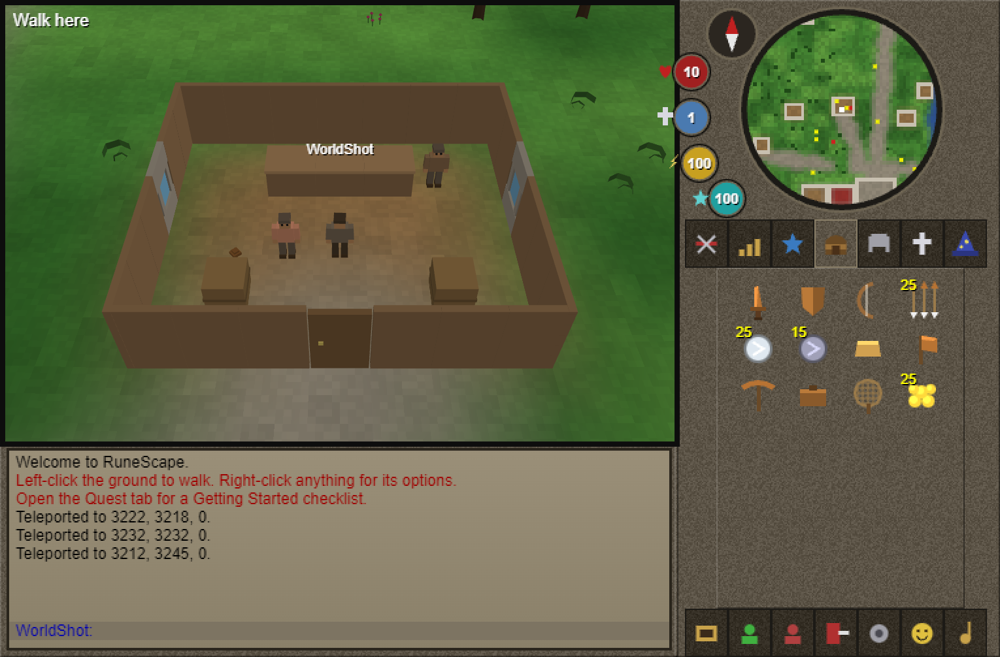

# osrs-clone

A playable Old School RuneScape clone, written from scratch in TypeScript: an
authoritative Node server running a 600ms game tick, and a WebGL2 browser client
that reproduces the 765x503 fixed-mode interface.

Everything is procedural. There are no art assets, no model files and no
textures anywhere in this repository — every character, tree, building, item
icon and skill glyph is generated in code at runtime.



## Quick start

```bash
npm install
npm run dev          # server on :43594, client with hot reload on :5173
```

Open <http://localhost:5173/>, type a display name and press **Play**. There is
no password and no registration — the name becomes your character, saved to
`data/players/<name>.json`.

For a production run:

```bash
npm run build        # typecheck + bundle into dist/client
npm start            # serves the built client and the game on :43594
```

> `npm start` serves the bundle in `dist/client`, so it will keep serving a
> stale client until you re-run `npm run build`.

## Controls

| Input | Action |
| --- | --- |
| Left click | Walk, or take the default action on whatever is under the cursor |
| Right click | Open the context menu for that target |
| Middle-drag / arrow keys | Rotate and pitch the camera |
| Mouse wheel | Zoom |
| Enter | Focus the chatbox |

Typing `::help` in chat lists the debug commands (`::item`, `::tele`,
`::setlevel`, `::master`, `::heal`, `::empty`, `::pos`, `::players`).

## What is in the game

| | |
| --- | --- |
| World | 256x256 tiles across 4 planes, 5,095 placed objects, 160 NPC spawns |
| Areas | Lumbridge, Lumbridge Swamp, Al Kharid, Al Kharid Mine, Draynor Village, Draynor Manor, Wizards' Tower, Lumbridge Swamp Caves, The Wilderness Road |
| Skills | 23 skills on the real XP curve to level 99; 17 of them trainable |
| Content | 388 items, 67 NPC types, 90 object types, 34 spells, 29 prayers, 11 shops |
| Combat | Melee, ranged and magic with OSRS accuracy and max-hit formulas, prayers, attack styles, aggression, drop tables |

Combat maths, the XP table, prayer drain rates and the container stacking rules
all follow the real formulas rather than approximations. See
[docs/gameplay.md](docs/gameplay.md) for the full content inventory, including an
honest list of what is stubbed or missing.

## Documentation

| Document | Contents |
| --- | --- |
| [docs/architecture.md](docs/architecture.md) | The authoritative-server model, the exact tick loop order, entity model, renderer, and client interpolation |
| [docs/protocol.md](docs/protocol.md) | Every wire message in both directions and the per-tick sync payload |
| [docs/gameplay.md](docs/gameplay.md) | What is actually implemented: skills, combat, magic, prayer, items, NPCs, world, quests |
| [docs/development.md](docs/development.md) | Setup, the verification harnesses, debugging, and the traps this codebase sets for you |
| [AGENTS.md](AGENTS.md) | Condensed orientation notes for AI coding agents |

## Layout

```
src/shared/    code both sides need: wire protocol, combat maths, skills, game data, world/collision/pathfinding
src/server/    the authoritative simulation: tick loop, players, NPCs, combat, actions, dialogue
src/client/    frame loop, interpolated view of the server, WebGL2 renderer, 2D interface
src/test/      node:test unit tests
tools/         verification harnesses that play the game over the wire and through a real browser
```

## Verification

```bash
npm test             # 122 unit tests, no server needed
npm run build        # typecheck and bundle
npm run check:play   # 91 checks driven over the websocket   (needs a server)
npm run check:client # 50 checks driven through a real browser (needs a server)
npm run check:social # friends / ignore / private chat        (needs a server)
```

The two `check:*` harnesses actually play the game — walking, chopping,
fishing, fighting, banking, shopping, casting, praying and dying — and assert on
what the server replies and on what the client renders. There are also
screenshot harnesses (`shots:world`, `shots:tabs`, `shots:combat`) for eyeballing
the 3D view, the interface tabs and combat animations.

See [docs/development.md](docs/development.md) before changing anything.

## Requirements

Node 20+ and a browser with WebGL2. Development is on Windows and Linux; the
only native dependency is Playwright's Chromium, used by the browser checks.

## Licence and attribution

This is an independent, non-commercial reimplementation written for study. It
ships no Jagex code, art or data — all content is recreated procedurally from
public knowledge of the game. RuneScape and Old School RuneScape are trademarks
of Jagex Ltd, which is not affiliated with this project in any way.
